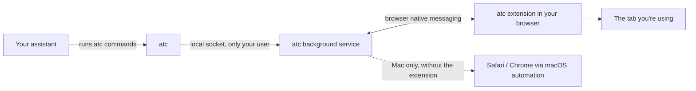

# Agentic Tab Context

**Let your coding assistant use the browser tab you already have open.**

## The problem

You ask Claude Code, Codex or Antigravity to check something on a web page. It opens a brand-new browser window. That window isn't logged in, isn't on the page you were looking at, and leaves another stray window behind.

## What this does

Agentic Tab Context (the command is `atc`) connects your assistant to the browser you're already using.

Say **"look at my browser"**, and the assistant finds the tab you mean. It can then read that tab, click, type, take screenshots and check for errors. It does all of this in the tab you already have open, with your logins intact.

## Quick start (about 2 minutes)

You need macOS or Linux, [Node.js](https://nodejs.org) 22 or newer, and Chrome (or another Chromium browser). Windows installation is unsupported and stops before writing files.

**1. Install**

```sh
git clone https://github.com/gainratio/agentic-tab-context.git
cd agentic-tab-context
./install.sh
```

This puts `atc` on your PATH and teaches Claude Code, Codex and Antigravity how to use it.

**2. Add the browser extension**

1. Open `chrome://extensions`.
2. Turn on **Developer mode** (top right).
3. Click **Load unpacked** and choose the `extension` folder inside this project.

**3. Check it works**

```sh
atc doctor
```

The `extension` section should list your browser as connected. If not, `nextSteps` tells you what to do.

**4. Ask your assistant**

> "Look at my browser. The checkout page shows an error after I click Pay. What's wrong?"

## Things you can ask

- "Look at my browser and tell me why the Save button does nothing."
- "On the localhost tab, fill in the signup form with test data and submit it."
- "Check the console on my open dashboard tab for errors."
- "Take a screenshot of the pricing page I have open."

You can also click the extension's toolbar icon and press **Let my assistant use this tab**.

## Which browsers work

| Browser | Uses your open tabs? | Status |
|---|---|---|
| Chrome, Chromium | Yes, with the extension | Chromium tested automatically on every change; installed Google Chrome not separately tested |
| Brave, Edge | Yes, with the extension | Same engine as Chrome; not tested yet |
| Firefox | Extension is written to support it | Not tested yet |
| Safari (Mac) | Discovery only: can list tabs; binding and actions are unsupported because Safari exposes no stable tab identity | Discovery tested with simulated responses; physical Safari unverified |
| Chrome, Brave, Edge on a Mac **without** the extension | Can bind by stable browser tab id; page access needs the Apple Events setting below. No screenshots. | Tested with simulated responses only |

In Chrome, Brave and Edge on macOS, the setting is **View > Developer > Allow JavaScript from Apple Events**. You only need it if you don't install the extension. Enabling Safari automation does not enable Safari binding in atc.

Need a separate, clean browser window instead? `atc open chromium` (or `firefox`, `webkit`) opens one that remembers its own logins.

## Is it safe?

- **The bridge is local.** atc opens no network listening port. The extension talks to atc through native messaging. Your assistant's handling of returned content follows its own settings and terms; normal website requests still occur.
- **Password controls are redacted from inspection.** Log in yourself, as usual. Values supplied through `atc type` are passed to the page and removed from error messages. Ordinary page text, console messages and network addresses can still contain sensitive information.
- **Your assistant can read whatever is on the tab you give it.** Only let it use tabs you're happy to share. Web pages can contain text aimed at AI assistants, so treat what a page says as information, not instructions.

## Commands

You rarely need these yourself; your assistant runs them. Every command prints one line of JSON.

| Command | What it does |
|---|---|
| `atc tabs` | List the tabs open in your browsers |
| `atc bind "localhost"` | Connect to the open tab matching "localhost" (also `--active`, `--tab <id>`) |
| `atc inspect` | Describe what's visible on the tab: headings, buttons, fields, text |
| `atc click --role button --name "Save"` | Click something, matched by its exact name |
| `atc type --label "Email" --value "a@b.co"` | Type into a field |
| `atc select --label "Plan" --value "Pro"` | Choose a dropdown option |
| `atc screenshot` | Save a picture of the tab |
| `atc console` / `atc network` | Show console messages / network requests |
| `atc goto <url>` / `back` / `reload` | Move around |
| `atc doctor` | Check that everything is connected |
| `atc setup` | Reinstall the assistant skill and browser connection |

Element actions require one exact match. Tab binding prefers a unique exact URL/title match, then a unique active tab; otherwise it lists the choices. Use `--tab <id>` when you need one specific tab.

Live extension screenshots capture the viewport. `--full-page` is supported for managed windows and explicitly rejected for live tabs.

The full reference (every flag, the output format, error codes) is in [docs/SPEC.md](docs/SPEC.md).

## How it works



The first `atc` command starts a small background service. It remembers which tab you connected to, so separate commands keep working on the same tab. The extension reports your open tabs to that service and carries out its commands inside the tab.

## Troubleshooting

| You see | Do this |
|---|---|
| `atc doctor` shows no connected extension | Run `atc setup`, then reload the extension at `chrome://extensions` |
| "blocks page access from other apps" | Install the extension, or turn on the Apple Events setting above |
| `AMBIGUOUS_TARGET` | Several things matched. Use `atc tabs` and `atc bind --tab <id>`, or add `--nth 1` for elements |
| Safari binding is unsupported | Use tab discovery only, or choose a supported Chromium browser |
| A reload is required after an update | Reload the affected page, then bind it again to replace the old page agent |

## Update or remove

To update your clone, stop atc, pull the reviewed changes, and rebuild:

```sh
atc shutdown
git pull --ff-only
./install.sh
```

Reload the extension in your browser and reload previously bound pages after updating, then run `atc doctor`.

To remove it, run `atc shutdown` and `npm unlink --global agentic-tab-context`, then remove the browser extension. Remove the `nativeHostManifests` and `installedSkills` files listed in your original setup output. The native manifests are named `com.gainratio.atc.json` in the browser's native-host folder. Keep `~/.atc` (or your `ATC_HOME`) if you want to retain managed-browser logins and saved screenshots; delete it only when you intend to remove those too. The clone can then be removed.

The npm package is private. Local archives include the compiled CLI and extension assets; publishing an npm package or Chrome Web Store build is a separate release action.

## Contributing

```sh
npm run gate               # build, type-check, and run all tests (including a real browser)
dagger call quality sync   # the same gate inside a pinned container, as CI runs it
```
