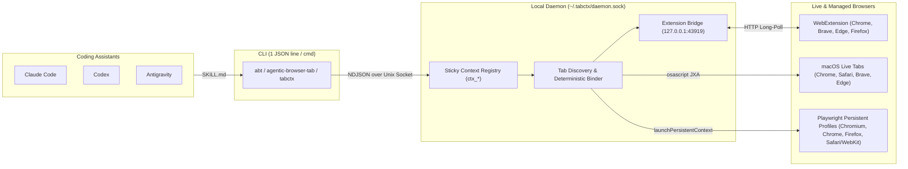

# Agentic Browser Tab (`abt`)

> **Stop coding assistants from opening redundant browser windows and tabs.** When you say *"look at my browser"*, `abt` finds the exact tab you already have open, binds to it in place, and gives Claude Code, Codex, and Antigravity a sticky, deterministic JSON session across commands.

---

## TL;DR

1. **What it is:** A lightweight, zero-credential CLI (`abt`, `agentic-browser-tab`, and `tabctx`) + WebExtension + coding-assistant skill that binds AI coding assistants directly to the browser tab you already have open across **Chrome, Safari, Firefox, Brave, Edge, and WebKit/Chromium**.
2. **Why it works:** Coding assistants normally launch a fresh headless browser or open a new tab on every turn — losing your login session, MFA state, DevTools state, and open page. `abt` keeps a lightweight local daemon (`~/.tabctx/daemon.sock`) that discovers your live tabs (via the Manifest V3 WebExtension on `127.0.0.1:43919`, macOS native JXA tab discovery, or managed Playwright sessions), binds to the matching tab (`ctx_<hex>`), and runs every subsequent `inspect`, `click`, `type`, `select`, `console`, `network`, and `screenshot` command against that exact tab.
3. **Worked example — *"Look at my browser"*:**
   ```sh
   # 1. Discover and bind to the tab you already have open (by query, URL, title, or active tab):
   abt bind "localhost"
   # => {"ok":true,"context":"ctx_7f21","tabId":"macos:chrome:1:3","browser":"chrome","source":"macos","url":"http://localhost:5181/","title":"EdgeReco","current":true,"reused":false}

   # 2. Inspect the live ARIA tree and interact with deterministic locators:
   abt inspect
   # => {"ok":true,"context":"ctx_7f21","url":"http://localhost:5181/","title":"EdgeReco","aria":"- heading \"EdgeReco\"..."}

   abt click --role button --name "Save"
   # => {"ok":true,"context":"ctx_7f21","matched":1}

   abt console --since 0
   # => {"ok":true,"context":"ctx_7f21","entries":[],"next":0}
   ```
4. **Core invariants:**
   - **Bind first, never open a redundant tab:** `abt bind` attaches to your existing tab; if multiple tabs match, it fails closed with `AMBIGUOUS_TARGET` and returns the candidate list rather than guessing.
   - **Deterministic visible-only locators:** `click`, `type`, and `select` match only visible elements with exact names/labels. Multiple matches fail closed with `AMBIGUOUS_TARGET` unless disambiguated with `--nth N`.
   - **One line of JSON per command:** Every command prints exactly one compact JSON object to `stdout` and exits `0` iff `"ok": true`.
   - **Zero credential handling:** Humans log in (passwords, SSO, MFA, passkeys) in their own browser; typed values are automatically redacted from error output.

---

## Architecture



---

## 1-Command Install

Requires Node.js 22+.

```sh
./install.sh
```

`./install.sh` builds the TypeScript source, links `abt`, `agentic-browser-tab`, and `tabctx` onto your `PATH`, installs the `agentic-browser-tab` skill into:
- `~/.claude/skills/agentic-browser-tab/SKILL.md` (Claude Code)
- `~/.codex/skills/agentic-browser-tab/SKILL.md` (OpenAI Codex)
- `~/.gemini/antigravity/skills/agentic-browser-tab/SKILL.md` (Google Antigravity)
- `~/.agents/skills/agentic-browser-tab/SKILL.md` (Universal Agent Skills)

and runs `abt doctor` to verify your installed browsers and live tab discovery.

You can also run setup or diagnostics anytime:

```sh
abt setup
abt doctor
```

---

## Connecting to Your Existing Browser Tab

`abt` supports three complementary ways to work with browsers:

### 1. Zero-Config macOS Live Tab Discovery (`source: "macos"`)
Out of the box on macOS, `abt tabs` and `abt bind` immediately discover all open windows and tabs across **Google Chrome**, **Safari**, **Brave Browser**, and **Microsoft Edge** with zero permission popups:

```sh
abt tabs
abt bind "aml-filter"          # or: abt bind --active
abt goto http://localhost:5182/customers
```

> **Note for DOM inspection (`inspect`, `click`, `type`, `select`) on macOS live tabs:** Either load the unpacked WebExtension below (recommended, works on all platforms) or enable **View → Developer → Allow JavaScript from Apple Events** in Chrome/Safari.

### 2. Universal Browser Extension (`source: "extension"`, Chrome / Brave / Edge / Firefox)
For full DOM inspection, clicks, form fills, screenshots, and console/network capture in your everyday browser without enabling Apple Events or `--remote-debugging-port`:

1. Open `chrome://extensions` (or `brave://extensions` / `edge://extensions`).
2. Enable **Developer mode** (top right) and click **Load unpacked**.
3. Select the `extension/` folder inside this repository (printed by `abt setup`).
4. Click the **Agentic Browser Tab** toolbar icon to pin your active tab, or run `abt bind --active` from the terminal.

### 3. Managed Persistent Multi-Browser Profiles (`source: "managed"`)
When you want a dedicated persistent browser window where logins/cookies survive across runs:

```sh
abt open chrome --use          # or: chromium | firefox | safari | webkit | brave | edge
abt open firefox --headless --use
abt open safari --use
```

---

## Command Reference

| Command | Result |
|---|---|
| `abt bind [query] [--query Q] [--url U] [--title T] [--browser B] [--tab ID] [--active] [--use]` | `{ok, context, tabId, browser, source, url, title, current, reused}` — binds to an already-open tab |
| `abt tabs [query] [--browser B] [--query Q] [--active]` | `{ok, tabs: [...]} ` — lists all open tabs across extension, macOS, and managed browsers |
| `abt open <browser> [--profile P] [--headless] [--use]` | `{ok, context, browser, profile, current}` — `browser`: `chromium`, `chrome`, `brave`, `edge`, `firefox`, `safari`, `webkit`, `extension` |
| `abt list` | `{ok, contexts: [...], current}` |
| `abt use <ctx>` | `{ok, context}` — make `<ctx>` the current context |
| `abt current` | `{ok, context}` (or `NO_CURRENT_CONTEXT`) |
| `abt close [ctx] [--context C]` | `{ok, context}` — closes `<ctx>` or the current context |
| `abt goto <url> [--context C]` | `{ok, context, url, title}` — relative URLs resolve against the current page |
| `abt back` / `forward` / `reload` | `{ok, context, url, title}` |
| `abt inspect [--context C]` | `{ok, context, url, title, aria}` — ARIA snapshot (YAML) of visible elements |
| `abt screenshot [--out F] [--full-page]` | `{ok, context, path, bytes}` — writes PNG (default under `$ABT_HOME/screenshots`) |
| `abt console [--since N]` | `{ok, context, entries, next}` — pass `--since <next>` for incremental logs |
| `abt network [--since N]` | `{ok, context, entries, next}` |
| `abt click <target>` | `{ok, context, matched: 1}` |
| `abt type <target> --value V` | `{ok, context, matched: 1}` |
| `abt select <target> --value V` | `{ok, context, matched: 1}` |
| `abt doctor` | `{ok, pid, home, current, openContexts, liveTabs, extensionBridge, browsers}` |
| `abt setup` | `{ok, cli, installedSkills, extensionPath, browsers}` |
| `abt shutdown` | Stops the background daemon (`{ok, running: false}` if none was running) |
| `abt help` / `--help` / `-h` | `{ok, usage: [...]}` |

---

## Targets and Determinism

`click`, `type`, and `select` require **exactly one** locator flag:

| Flag | Matches |
|---|---|
| `--role R [--name N]` | Visible elements with ARIA role `R` (and exact accessible name `N`) |
| `--label L` | Visible form controls labelled `L` |
| `--text T` | Visible elements whose exact text is `T` |
| `--placeholder P` | Visible inputs with placeholder `P` |
| `--testid ID` | Visible elements with `data-testid="ID"` |
| `--selector CSS` | Visible elements matching CSS selector `CSS` |

Add `--nth N` (0-based integer) to disambiguate when multiple visible elements match.

---

## Multi-Browser Support Matrix

| Browser Target | Live Tab Discovery & Bind | Managed Persistent Context (`abt open`) | Engine |
|---|---|---|---|
| `chrome` | ✅ Extension + macOS JXA | ✅ System Chrome / Playwright Chromium | Blink |
| `chromium` | ✅ Extension + macOS JXA | ✅ Playwright Chromium | Blink |
| `brave` | ✅ Extension + macOS JXA | ✅ System Brave / Playwright Chromium | Blink |
| `edge` | ✅ Extension + macOS JXA | ✅ System Edge / Playwright Chromium | Blink |
| `firefox` | ✅ Extension | ✅ Playwright Firefox / System Firefox | Gecko |
| `safari` | ✅ macOS JXA + Extension | ✅ Playwright WebKit | WebKit |
| `webkit` | ✅ Managed | ✅ Playwright WebKit | WebKit |
| `extension` | ✅ Active Extension Tab | ✅ Binds active extension tab | Any |

---

## Environment Variables

| Variable | Effect |
|---|---|
| `ABT_HOME` / `TABCTX_HOME` | State directory (default `~/.tabctx`). Separate homes run isolated daemons. |
| `ABT_HEADLESS` / `TABCTX_HEADLESS` | `1` makes `open` headless by default (`--headless` always forces headless). |
| `ABT_BROWSER_PATH` / `TABCTX_CHROMIUM_PATH` | Explicit browser executable override. |
| `ABT_BRIDGE_PORT` | Localhost port for the WebExtension HTTP bridge (default `43919`). |

---

## Development & Verification

```sh
npm run build
npm run typecheck
npm test
npm audit
```
