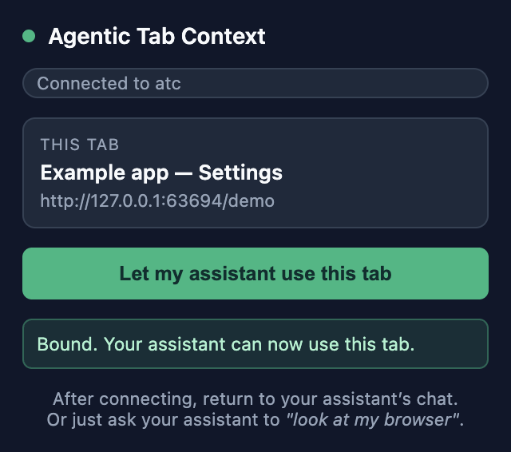
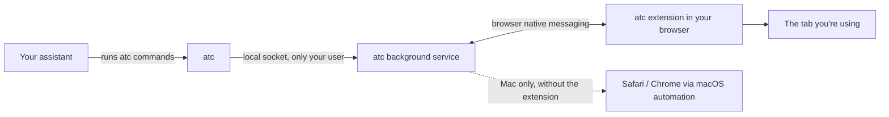

# Agentic Tab Context

**Let your coding assistant use the browser tab you already have open.**

Keep your website open and ask Claude Code, Codex or Antigravity for help. Agentic Tab Context connects your assistant to that page, with your existing logins. You write requests in your usual assistant chat.

First time here? Complete the [one-time installation](#one-time-installation), including the steps for your assistant.

## Everyday use: just ask

1. **Open your website** in the browser you normally use. Log in yourself if needed.
2. **Ask your assistant about the page.** For example: “On my open Example app settings page, why does Save do nothing?” Include the site name or address when you have several tabs open.
3. **The assistant finds the tab and checks it.** It uses the open tabs' titles, addresses, and active-tab information to choose the page. If the target is still unclear, it asks which tab you mean.

You do not need to click the extension for each request or type terminal commands yourself. The assistant uses `atc` to read the page, interact with it, take screenshots, and check errors.

## Optional: point to one exact tab

If you prefer to choose the page yourself, use the small popup in your browser toolbar:

1. On the page you want help with, open Chrome's **Extensions** menu and select **Agentic Tab Context**. If its icon is pinned, click that directly.
2. Check the page shown under **This tab**, then press **Let my assistant use this tab**.
3. Wait for **“Bound. Your assistant can now use this tab.”** Return to your assistant chat and say, “Look at the tab I selected.”



*The actual Chrome popup, shown with a local demonstration page. This popup selects a page; your conversation stays in your coding assistant.*

## One-time installation

You need macOS or Linux, Git, [Node.js](https://nodejs.org) 22 or newer with npm, and Chrome (or another Chromium browser). Open the browser once before installing so setup can find its profile. Windows installation is unsupported and stops before writing files.

**1. Install**

```sh
git clone https://github.com/gainratio/agentic-tab-context.git
cd agentic-tab-context
./install.sh
```

This builds the CLI, links `atc` into npm's global executable folder, installs the assistant skill for all three assistants, and registers the browser bridge. Keep the clone in place: the CLI and browser bridge use files inside it.

**2. Add the browser extension**

1. Open `chrome://extensions`.
2. Turn on **Developer mode** (top right).
3. Click **Load unpacked** and choose the `extension` folder inside this project.

**3. Check the browser connection**

```sh
atc doctor
```

The `extension.connected` array should list your browser. If not, `nextSteps` tells you what to do. This checks the browser bridge; verify assistant discovery separately using the steps below.

**4. Connect your assistant and ask**

Follow the activation steps for [Claude Code](#claude-code), [Codex](#codex), or [Antigravity](#antigravity) below. The installer adds the skill files; your assistant also needs to discover them and be able to run `atc`. Once connected, ask:

> "Look at my browser. The checkout page shows an error after I click Pay. What's wrong?"

The assistant discovers the page automatically. The [toolbar popup](#optional-point-to-one-exact-tab) is an optional way to choose a particular tab; open it from the toolbar rather than opening `popup.html` as a file.

## Connect your assistant

There are two pieces: the **browser extension** gives access to your open tabs, and an **assistant skill** teaches your coding assistant to run `atc`. The standard installation uses local skill folders; it requires no MCP server or marketplace registration. Run the assistant on the same machine as the browser.

`./install.sh` already installs all three skill copies. If you installed the CLI earlier and need to add or refresh them, run:

```sh
atc setup
```

Setup prints `installedSkills`, `nativeHostManifests`, and `extension.folder`. It replaces the bundled skill copies at these locations:

| Assistant | Skill file installed for your user account |
|---|---|
| Claude Code | `~/.claude/skills/agentic-tab-context/SKILL.md` |
| Codex | `~/.agents/skills/agentic-tab-context/SKILL.md` |
| Antigravity | `~/.gemini/config/skills/agentic-tab-context/SKILL.md` |

### Claude Code

1. Start a new local Claude Code session after installation.
2. Type `/agentic-tab-context` to select the installed skill, then ask:

   ```text
   /agentic-tab-context Look at my browser and describe the page I have open.
   ```

3. Confirm it runs `atc` and reports the intended page. If the command is missing, restart Claude Code and check the skill file listed above.

The clone also includes a Claude Code plugin manifest. For an optional, session-only plugin load, launch Claude Code with the clone's absolute path:

```sh
claude --plugin-dir /absolute/path/to/agentic-tab-context
```

That exposes `/agentic-tab-context:agentic-tab-context` for that session. It still needs the CLI and browser setup above. The standard skill installation is sufficient; the local plugin route has not been exercised in this project's end-to-end tests. See Claude Code's [skills](https://code.claude.com/docs/en/skills) and [local plugin loading](https://code.claude.com/docs/en/plugins/install) documentation.

### Codex

1. Start a new local Codex chat after installation. If the skill is missing, restart Codex.
2. In Codex CLI or the IDE extension, use `/skills` or type `$` and select `agentic-tab-context`. You can invoke it directly with:

   ```text
   $agentic-tab-context Look at my browser and describe the page I have open.
   ```

3. Confirm Codex runs `atc` and reports the intended page. The desktop app can also use the skill when you explicitly ask it to use `agentic-tab-context`.

Codex discovers user skills from `~/.agents/skills`; no Claude plugin command is needed. See the official [Codex skills documentation](https://developers.openai.com/codex/skills).

### Antigravity

1. Start a new local Antigravity conversation after installation; restart the app if the skill is missing.
2. In the standalone IDE, check **Customizations** in the agent side panel for `agentic-tab-context`. In the Antigravity App, invoke `/agentic-tab-context`, or ask in any surface:

   ```text
   Use the agentic-tab-context skill to describe the page I have open in my browser.
   ```

3. Confirm the agent runs `atc` and reports the intended page.

The installer uses Antigravity's documented global skill folder, `~/.gemini/config/skills`. Actual Antigravity discovery and invocation have not been tested in this project. See the official [Antigravity skills documentation](https://antigravity.google/docs/skills/).

### Verify the whole connection

Ask your assistant to run `atc doctor`, list tabs with `atc tabs`, choose the intended page by title or address with `atc bind`, and read it with `atc inspect`. Success means it reports the actual page's title and visible content. These are commands for the assistant to run; manually choosing a tab in the popup is optional.

If the assistant reports `atc: command not found`, check `command -v atc` in its terminal environment. Ensure npm's global executable folder (`npm prefix -g`, followed by `/bin` on macOS/Linux) is on that environment's PATH, then restart the assistant. From the clone, `node bin/atc.js doctor` checks the CLI without the global link.

## Things you can ask

- "Look at my browser and tell me why the Save button does nothing."
- "On the localhost tab, fill in the signup form with test data and submit it."
- "Check the console on my open dashboard tab for errors."
- "Take a screenshot of the pricing page I have open."

## Which browsers work

| Browser | Uses your open tabs? | Status |
|---|---|---|
| Chrome, Chromium | Yes, with the extension | Chromium tested automatically on every change; installed Google Chrome 155 tested locally on macOS for toolbar binding, page actions, screenshots, logs, redaction, and close/rebind |
| Brave, Edge | Yes, with the extension | Same engine as Chrome; not tested yet |
| Firefox | Extension is written to support it | Not tested yet |
| Safari (Mac) | Discovery only: can list tabs; binding and actions are unsupported because Safari exposes no stable tab identity | Discovery tested with simulated responses; physical Safari unverified |
| Chrome, Brave, Edge on a Mac **without** the extension | Can bind by stable browser tab id; page access needs the Apple Events setting below. No screenshots. | Tested with simulated responses only |

In Chrome, Brave and Edge on macOS, the setting is **View > Developer > Allow JavaScript from Apple Events**. You only need it if you don't install the extension. Enabling Safari automation does not enable Safari binding in atc.

Need a separate, clean browser window instead? `atc open chromium` (or `firefox`, `webkit`) opens one that remembers its own logins.

## Is it safe?

- **The bridge is local.** atc opens no network listening port. The extension talks to atc through native messaging. Your assistant's handling of returned content follows its own settings and terms; normal website requests still occur.
- **Password controls are redacted from inspection.** Log in yourself, as usual. Values supplied through `atc type` are passed to the page and removed from error messages. Ordinary page text, console messages and network addresses can still contain sensitive information.
- **Your assistant can read whatever is on the tab you give it.** Only let it use tabs you're happy to share. Web pages can contain text aimed at AI assistants, so treat what a page says as information, not instructions.

## Commands

You rarely need these yourself; your assistant runs them. Every command prints one line of JSON.

| Command | What it does |
|---|---|
| `atc tabs` | List the tabs open in your browsers |
| `atc bind "localhost"` | Connect to the open tab matching "localhost" (also `--active`, `--tab <id>`) |
| `atc inspect` | Describe what's visible on the tab: headings, buttons, fields, text |
| `atc click --role button --name "Save"` | Click something, matched by its exact name |
| `atc type --label "Email" --value "a@b.co"` | Type into a field |
| `atc select --label "Plan" --value "Pro"` | Choose a dropdown option |
| `atc press Enter` | Press a key on the focused element (Enter, Escape, Tab, Space, arrows, Home/End, PageUp/Down, Backspace, Delete) |
| `atc click --role button --name "Delete" --within "row text"` | Scope the search to a container that contains that text |
| `atc upload --label "Resume" ./resume.pdf` | Attach a local file to a file input (8 MiB cap) |
| `atc eval "document.documentElement.scrollWidth"` | Evaluate one expression in the bound page and return its JSON value |
| `atc screenshot` | Save a picture of the tab |
| `atc console` / `atc network` | Show console messages / network requests |
| `atc goto <url>` / `back` / `reload` | Move around |
| `atc doctor` | Check that everything is connected |
| `atc setup` | Reinstall the assistant skill and browser connection |

Element actions require one exact match. Tab binding prefers a unique exact URL/title match, then a unique active tab; otherwise it lists the choices. Use `--tab <id>` when you need one specific tab.

Live extension screenshots capture the viewport. `--full-page` is supported for managed windows and explicitly rejected for live tabs.

The full reference (every flag, the output format, error codes) is in [docs/SPEC.md](docs/SPEC.md).

## Optional: Browser MCP and Chrome DevTools

ATC's extension already provides tab discovery, page actions, screenshots, and console/network capture. That is the default connection described above.

For additional debugging, [Chrome DevTools for agents](https://github.com/ChromeDevTools/chrome-devtools-mcp) offers performance traces and deeper browser diagnostics. [Browser MCP](https://browsermcp.io/) is another way to automate an existing browser through its own extension and MCP server. These are optional, separately configured tools; ATC does not install them.

When using another tool, select and verify the intended page in that tool before taking actions. ATC does not currently map its tab IDs to another connector's targets or hand sessions between connectors. Do not assume their current pages are the same. Combined use has not been tested in this project.

## How it works



The first `atc` command starts a small background service. It remembers which tab you connected to, so separate commands keep working on the same tab. The extension reports your open tabs to that service and carries out its commands inside the tab.

## Troubleshooting

| You see | Do this |
|---|---|
| `atc doctor` shows no connected extension | Run `atc setup`, then reload the extension at `chrome://extensions` |
| Extension connected, but the assistant cannot find the skill | Follow [Connect your assistant](#connect-your-assistant); check its installed skill file and start a new session |
| Assistant reports `atc: command not found` | Check npm's global executable folder is on the assistant's PATH; see [Verify the whole connection](#verify-the-whole-connection) |
| "blocks page access from other apps" | Install the extension, or turn on the Apple Events setting above |
| `AMBIGUOUS_TARGET` | Several things matched. Use `atc tabs` and `atc bind --tab <id>`, or add `--nth 1` for elements |
| Safari binding is unsupported | Use tab discovery only, or choose a supported Chromium browser |
| A reload is required after an update | Reload the affected page, then bind it again to replace the old page agent |

## Update or remove

To update your clone, stop atc, pull the reviewed changes, and rebuild:

```sh
atc shutdown
git pull --ff-only
./install.sh
```

Reload the extension in your browser and reload previously bound pages after updating, then run `atc doctor`.

To remove it, run `atc shutdown` and `npm unlink --global agentic-tab-context`, then remove the browser extension. Remove the `nativeHostManifests` and `installedSkills` files listed in your original setup output. The native manifests are named `com.gainratio.atc.json` in the browser's native-host folder. Keep `~/.atc` (or your `ATC_HOME`) if you want to retain managed-browser logins and saved screenshots; delete it only when you intend to remove those too. The clone can then be removed.

The npm package is private. Local archives include the compiled CLI and extension assets; publishing an npm package or Chrome Web Store build is a separate release action.

## Contributing

```sh
npm run gate               # build, type-check, and run all tests (including a real browser)
dagger call quality sync   # the same gate inside a pinned container, as CI runs it
```
